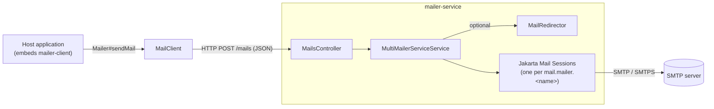

# Mailer — Architecture

## Purpose and scope

**Does**

- Accepts an email message as JSON on `POST /mails` and delivers it over SMTP before the HTTP call
  returns. (`mailer-service/.../MailsController.java#send`, `service/MailerService.java#sendMail`)
- Supports several sender accounts and picks one per message from the `from` address.
  (`service/MultiMailerServiceService.java#getSessionFromHost`)
- Optionally redirects all mail to a fixed list of addresses, for test and beta deployments.
  (`service/MailRedirector.java`)
- Provides a Spring Boot client, `mailer-client`, that implements the same `Mailer` interface over
  HTTP.

**Does not**

- Queue, persist, retry or track messages.
- Authorise individual callers. The only protection is an optional shared API key
  (`config/ApiKeyFilter`).
- Render templates or support attachments. The message is plain text or HTML only.
  (`EmailMessage`)

## Technical stack

| Item | Value | Evidence |
|---|---|---|
| Java | 17 (Spring Boot parent default, no override) | `pom.xml` |
| Framework | Spring Boot 3.5.15, Spring MVC, `RestClient` | `pom.xml`, `mailer-*/pom.xml` |
| Mail | `jakarta.mail-api` 2.1.5, `org.eclipse.angus:jakarta.mail` 2.0.5 | `pom.xml` `dependencyManagement` |
| Logging | Log4j2 (`spring-boot-starter-log4j2`, Logback excluded) | `mailer-service/pom.xml`, `mailer-client/pom.xml` |
| Build | Maven wrapper, `license-maven-plugin` (header check at `validate`), `maven-release-plugin` | `pom.xml` |
| Native image | `native-maven-plugin` declared on `mailer-service` | `mailer-service/pom.xml` |

## Main modules and responsibilities

| Module | Responsibility | Key types |
|---|---|---|
| `mailer-core` | Contract shared by service and client | `domain/EmailMessage` (`from`, `to`, `cc`, `bcc`, `subject`, `text`, `html`), `service/Mailer`, `RelativePaths.MAILS = "/mails"`, `MailerHeaders.API_KEY = "X-API-Key"` |
| `mailer-service` | Deployable Spring Boot app | `MailerApplication`, `MailsController`, `config/MailerProperties`, `config/ApiKeyFilter`, `exception/InvalidEmailException` (400), `exception/MailDeliveryException` (502), `service/MailerService` (default methods that build the MIME message and send it), `service/MultiMailerServiceService` (session registry and account selection), `service/MailRedirector`, `service/MailSessionUtils` |
| `mailer-client` | Auto-configured `Mailer` bean for other Spring Boot apps | `client/config/MailClientConfig` (`@AutoConfiguration`), `client/config/MailClientProperties` (`mailer.client.*`), `client/service/MailClient` |

## Component diagram

Source: [diagrams/component-diagram.mmd](diagrams/component-diagram.mmd)

## Main data flow

1. `ApiKeyFilter` checks `X-API-Key` when `mail.api-key` is set (401 otherwise). `MailsController#send`
   receives an `EmailMessage` and calls `MultiMailerServiceService#sendMail`.
2. `MailerService#validate` requires a non-blank `from` and at least one valid recipient (400 otherwise).
   If redirect is enabled, `MailRedirector#redirect` replaces the recipients with
   `mail.redirect.to`, prefixes the subject with `[REDIRECTED] ` and can append masked original
   recipients.
3. `getSessionFromHost` picks the session whose `mail.from` property equals `from`, or whose
   account name appears in `from`, iterating in configuration order. Otherwise it falls back to the
   first configured account.
4. `MailerService#createMessage` builds a `MimeMessage`. The display name comes from the session
   property `mail.display-name`, the subject defaults to `[No Subject]`, and the body is UTF-8 HTML
   when `html=true`. Invalid addresses are logged and dropped. If the message can't be built, the request
   fails with 400.
5. `Transport.send` delivers the message. A `MessagingException` is logged and rethrown as
   `MailDeliveryException` (502).
6. Otherwise the controller returns `201 Created`.

## Data and state

There's no database or file storage. The only state is the in-memory map of account name to Jakarta
Mail `Session`, built at startup from `mail.mailer.*` with default SMTP timeouts
(`MailSessionUtils#withDefaultTimeouts`). If a session fails to build, it's logged and skipped; if none
can be built, startup fails. (`MultiMailerServiceService` constructor)

## Security

Authentication is a single optional shared key, so the API should still be reachable only from trusted
networks. See [security.md](security.md).

## Significant design decisions

- **Synchronous delivery with no persistence.** The caller learns the outcome (201 or 502), but a failed
  send isn't retried, and a slow SMTP server holds the HTTP request open up to the SMTP timeouts.
- **Shared core module**, so the client and the service compile against the same DTO and path
  constant.
- **Redirect mode is enforced server-side**, so non-production deployments can't email real users
  whatever the callers send. (`MailRedirector`, `MailerServiceIntegrationTests`)
