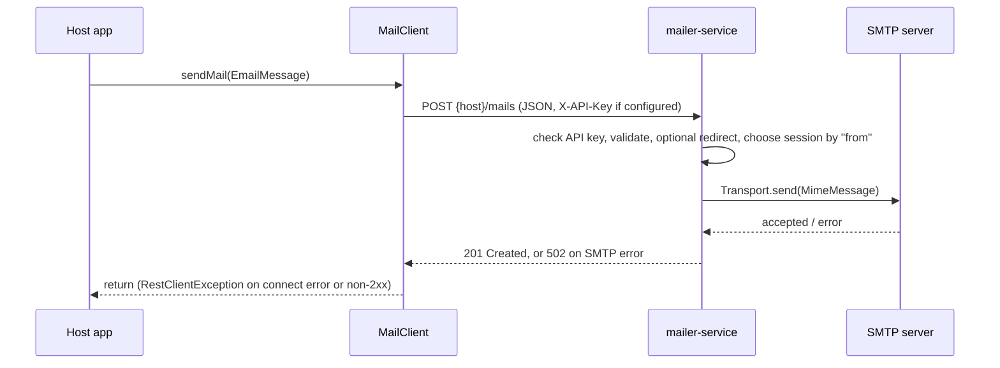

# Mailer — Integrations

| Direction | Counterpart | Protocol | Purpose | Configuration key | Evidence path/symbol |
|---|---|---|---|---|---|
| provided | Any HTTP caller, typically an application embedding `mailer-client` | REST, `POST /mails`, `application/json` | Send an email | `server.port`, `server.servlet.context-path`, `mail.api-key` | `mailer-service/.../MailsController.java#send` |
| consumed | SMTP server(s) (external) | SMTP or SMTPS through Jakarta Mail `Transport.send` | Deliver mail | `mail.mailer.<name>.*` | `mailer-service/.../service/MailerService.java#sendMail(Message)`, `MailSessionUtils#createSession` |
| provided (library) | Host Spring Boot application | In-process `Mailer` bean | Send email through the service | `mailer.client.host`, `mailer.client.api-key`, `mailer.client.connect-timeout`, `mailer.client.read-timeout` | `mailer-client/.../MailClientConfig.java#mailerClient` |
| consumed (library) | `mailer-service` | HTTP `POST {mailer.client.host}/mails` | The client's implementation of `Mailer` | `mailer.client.host`, `mailer.client.api-key` | `mailer-client/.../MailClient.java#sendMail` |

Which applications embed `mailer-client` is recorded in their own documentation.

## Provided interfaces

- REST: [api.md](api.md). No OpenAPI document is generated.
- Java: `gr.athenarc.messaging.mailer.service.Mailer#sendMail(EmailMessage)`, auto-configured by
  `mailer-client` through
  `META-INF/spring/org.springframework.boot.autoconfigure.AutoConfiguration.imports`.

## Sequence: send through the client

## Failure behaviour

| Situation | Behaviour | Evidence |
|---|---|---|
| SMTP rejects the message, authentication fails, or the server is unreachable | Logged at `ERROR` and returned as **502** (`MailDeliveryException`) | `MailerService#sendMail(Message)`, `MailerServiceIntegrationTests#rejectsWrongPassword` |
| Building the MIME message fails (for example bad encoding) | **400** (`InvalidEmailException`). Nothing is sent | `MailerService#createMessage` |
| `from` missing, or no valid recipient in `to`/`cc`/`bcc` | **400** (`InvalidEmailException`) | `MailerService#validate`, `MailsControllerTests` |
| Some recipient addresses invalid | Logged and dropped. The rest of the message is still sent | `MailerService#toAddress` |
| `X-API-Key` missing or wrong while `mail.api-key` is set | **401** | `ApiKeyFilter`, `MailsControllerTests` |
| No sender accounts configured | Startup fails with `IllegalStateException` | `MultiMailerServiceService` constructor |
| Client can't connect, times out, or gets a non-2xx response | `RestClientException` propagates to the caller | `MailClient#sendMail` (`retrieve().toBodilessEntity()`) |
| Client timeouts | Connect 5 s and read 10 s by default | `MailClientProperties.Client` |
| Retries / circuit breaking | None on either side | `MailClient`, `MultiMailerServiceService` |
| SMTP timeouts | Connect 10 s, read and write 30 s by default (`smtp` and `smtps`), overridable under `props` | `MailSessionUtils#withDefaultTimeouts` |
